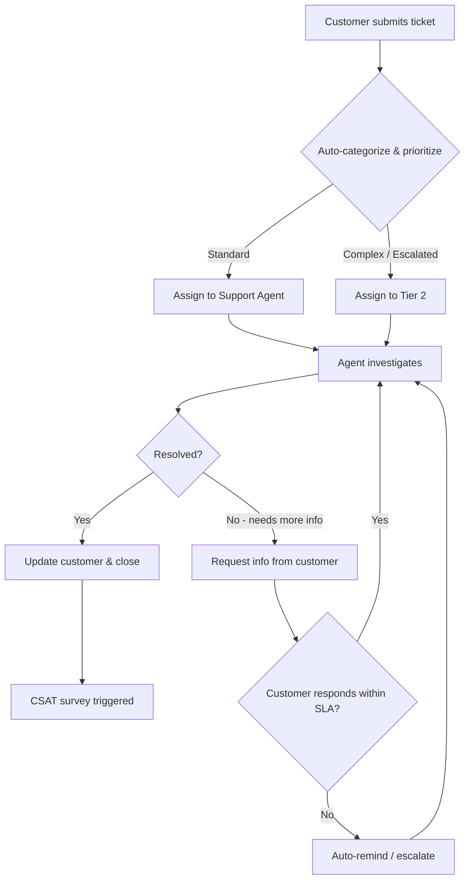

# Sample Process Model (BPMN-Style Text + Mermaid)

This artifact demonstrates how a Business Analyst can document a process clearly for both business and technical audiences.

---

## Process: Customer Support Ticket Resolution (Simplified)

### Purpose
Handle inbound customer support tickets from creation to resolution and closure, ensuring SLA adherence and customer satisfaction.

### Actors
- Customer
- Support Agent
- Tier 2 Specialist
- System (ticketing platform)

---

## Mermaid Flow (Happy Path + Exception)

---

## Textual Swimlane Summary

| Step          | Customer          | Support Agent         | Tier 2        | System            |
|------         |----------         |---------------        |--------       |--------           |
| 1. Submit     | Creates ticket    |                       |               | Logs & categorizes|
| 2. Route      |                   | Receives if standard  | Receives 
                                                                if complex  | Applies rules     |
| 3. Investigate|                   | Works ticket          | Works ticket  | Tracks time vs SLA|
| 4. Pending    | Provides more info| Requests info         |               | Starts pending 
                                                                                timer           |
| 5. Resolve    |                   | Closes with resolution| Closes with 
                                                                resolution  | Triggers CSAT     |
| 6. Feedback   | Responds to survey|                       |               | Records score     |

---

## Key Business Rules
- First response SLA: 4 business hours (standard), 1 hour (high priority)
- Pending status max duration: 5 business days before auto-escalation
- CSAT survey sent within 1 hour of closure
- Tickets reopened within 7 days return to original agent when possible
